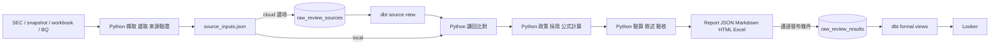
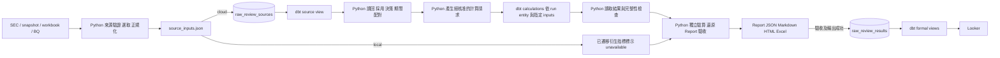

# 財務計算遷移計畫（使用者審閱草案）

> [PROPOSED] 本文件規劃未來遷移；截至 2026-11-18 未修改 production code、執行資料遷移或部署。已唯讀檢查雲端 metadata 並執行合成查詢，詳見下方更新。原始盤點基準與依據見 `CONTEXT_MAP.md`，十二項詳細規則見 `FINANCIAL_FORMULA_CATALOG.md`；業務定義批准另須證據，不由本草案推定。

> [VERIFIED] 2026-11-18 使用者確認：先測精度差異再審核具體規則；以既有 dataset 保存設定作設計基準，確認繼承權限及治理要求後才寫入；公式說明優先放 Loan Review 報告；先檢查實際 BigQuery 設定；local 不提供已遷移衍生指標並標示原因；DER 不自動啟用，先整理證據供審核。使用者同意開始程式工作，但未批准特定捨入規則或正式切換。
>
> [VERIFIED] 同日執行獨立合成 CF-01 BigQuery SELECT 與本機 dbt parse；沒有寫入正式資料表。`experiments/cf01_shadow/README.md` 記錄結果：1/3 的 Python/BigQuery 原始結果不同，而 `1E-39` 輸入在 BIGNUMERIC 轉換後變零，證明精確輸入檢查不可省略。此精度探針尚未接入正式 Report。

> [VERIFIED] 使用者之後核准以小數點後 4 位、`ROUND_HALF_EVEN` 執行。現已實作 CF-01 的分階段 opt-in：`--cf01-dbt`／HTTP `cf01_migration=true`；cloud 的 ephemeral dbt 計算結果須經 Python 驗證，本機選此選項時顯示不可提供。未變更預設路徑、部署或寫入新的 cloud request／receipt 類型。現存已接受且已發布的歷史 run 彙總中，沒有找到 calculated CF-01，可比歷史差異仍未確立。Python／dbt／Excel 的合成資料驗證不能取代資料治理審核及實際歷史覆蓋。
>
> [VERIFIED] 唯讀檢查 `gcloud projects describe` 未顯示 project 上層資源，project-level org-policy list 未列出政策；這不能證明適用於使用者的所有內部資料治理要求。使用者已確認 CF-01 輸入、未捨入值、來源證據與查詢紀錄可沿用 `focus-heuristic-438521-v4.sec_raw` 現有權限與保存設定；新版本發布仍需既有驗收與 dbt 重算，其他 project／dataset 未獲此確認。

## Migration Objective

[PROPOSED] 保留 Python 為資料擷取、資格控制與報告協調者，讓 dbt/BigQuery 成為**已明確核准範圍、正式 cloud run** 的衍生公式執行者；Python 做獨立驗證而不以驗證結果回填。復用既有 Report、來源儲存及發布關卡；先 CF-01 shadow，再逐項核准。現有正式／legacy 計算語意、已發行歷史 run 與直接來源資料保持可追溯。

## Current-State Architecture

[VERIFIED] 正式流程 `review_workflow.run_review` 以本機或 cloud 執行。Cloud `stage_bundle` 將原始已整理 bundle 寫 `raw_review_sources`，dbt source view 後回讀並比對；Python 採用輸入、計算、驗證及產製報告。唯有正式驗收及所有要求的輸出成功，`ReviewCloud.publish` 再次驗證，才寫 results、建立／測試 formal views 並記錄 run（`scripts/review_workflow.py:150-188,255-315`；`scripts/review_cloud.py:58-138`）。本機不預設使用 BigQuery。現有版本的主計算在 `loan_review_contract.py:approved_formula_value/calculate_identity`。

## Proposed Target Architecture

[PROPOSED] Python 維持 SEC/XBRL、entity/CIK、scope、單位、`as_of`、來源與政策、角色與財期配對、可計算資格、獨立 verification、reconciliation、commentary 和 acceptance。dbt 僅處理明確 formula_id/version 及有序輸入，不自行判斷會計身分或以最新日期猜選前期。新的 computation adapter interface 是 `calculate(requests) → complete responses`，至少校驗批次 fingerprint、run_id/entity、target fact、formula/version、inputs/evidence、status/value/reason；資料不完整或 DBT failure 必須明確終止或留作 draft，永不靜默補值。

[PROPOSED] 使用者已選擇：**local 模式不提供遷移後的衍生指標**。local 不引入 cloud／dbt 連線，不用 Python 算術 fallback；原本可用的直接列報值按既有 sourced 規則保留，不能冒稱 dbt 計算。遷移指標待算時維持既有 `not_calculable`、`value=None`、明確 reason，相關依賴按既有缺值規則處理。由既有 acceptance 評估是否為 draft，不預先宣稱所有情況一定 rejected。此選擇降低 local 報告完整性，為有意識的相容性變更，必須文件化並有測試。

## In-Scope and Out-of-Scope Calculations

[PROPOSED] 候選範圍為 DER-01..06、CF-01/02/03/04/09/16。每項仍需明確針對公式、版本、輸入、公司 scope 與現有政策授權；候選不代表逐公司 identity 定義已審核。

[VERIFIED] 預設正式路徑現在不帶 `identity_reviews`；DER 遷移不應默默啟用原先未啟用的衍生。`CF-16` 依賴上游 CF-11 的 operating margin；CF-11 暫不在此批，繼續作現有 Python 計算的顯式 upstream input。其他 CF-05/06/10/11/12、COMMON-SIZE、CASH-CHANGE、debt、EBITDA、LTM、DSCR、unit normalization、ratio commentary 與 validation 不在本次候選範圍（`loan_review_contract.py:61-110,322-353`）。

## Data Contracts and BigQuery Integration

### 經驗證的既有儲存與限制

- [VERIFIED] `raw_review_sources`/`raw_review_results`/`raw_review_runs` 共用字串 payload、append-only schema（`review_cloud.py:17-54`）。來源記錄種類只有 `metadata/inputs/evidence`，`read_bundle()` 遇到其他 kind 會 raise；直接把新的計算請求 kind 混入後重用它，會破壞舊 reader（`:58-87`）。
- [VERIFIED] 原始 bundle 在 `apply_approved_policy` 和 `adopt_inputs` 之前寫入；因此 **source bundle 本身不是已完成 eligibility 的計算請求**。cf. `review_workflow.py:180-188` 與 `loan_review_pipeline.py:52-153,549-559`。某些 input 在 source bundle 是輔助 input 或後續 derived Fact，CF-16 仍須依賴上游 CF-11。
- [VERIFIED] `stg_loan_review_run_sources.sql` 的去重 key 未包含 entity；不要把其當作可證明跨 entity 隔離的完整權限控制。`ReviewCloud.read_bundle()` 的 query 有參數化 run/entity 過濾，並驗證 UUID 格式。

### 最小候選 interface

1. [PROPOSED] 保持原 bundle 的 staging、讀回與 round-trip 不變。Python 完成政策與 adoption、檢查輸入與 target 後，建立不可變、帶 `run_id/entity/request_hash/batch_id` 的 eligibility request。對 DER 嚴格綁定 definition evidence、角色、unit、期間與循環檢查；對 CF-09/16 明確指定前後角色。每一筆保有 target/ordered input IDs、值與 scale、dates、source/evidence IDs、formula/version、approval、可用狀態及拒絕原因。
2. [PROPOSED] 優先研究同一 `raw_review_sources` 中獨立 `record_kind=calculation_request`，在**成功的來源 round-trip 之後**追加，且修改 `read_bundle` 為明確僅讀原有三類或提供版本化 reader；不可直接把新 kind 交給現有 reader。沿用 schema 不代表不用程式改動；新增 kind、既有舊 reader、歷史 source_run_id 和重複執行均需向後相容測試。另一候選是 BigQuery query parameter 作暫時輸入，若 dbt adapter 可安全支援，但可重播性須額外解決。是否追加 kind 為待確認介面決策，不預設新表。
3. [PROPOSED] 建立 formal 計算 view/model，按 request 中精確有序 inputs 執行核准公式；不得重用 legacy KPI 邏輯。固定 view 針對所有 run 定義；Python 用參數化 BigQuery query 讀取指定 `run_id + entity + batch_id + request_hash`，避免以每個 run 重建共用 view 定義造成併發覆寫。dbt 建置／測試的 run 範圍與權限另需驗證。不要把敏感值或未檢查輸入插入 dbt vars 的 SQL 文字。
4. [PROPOSED] 結果需一筆對一筆，包含 success 或原因；拒絕 missing、duplicate、extra、錯 entity/run、錯 formula/version、不同 input fingerprint、未知 status、lossy cast、overflow。按依賴拓樸分批（例如 DER 可供 CF-04、CF-11 可供 CF-16）；每批回讀與驗證後才釋出下一批，保留既有避免循環機制。
5. [PROPOSED] Python 在同一 contract 中還原 Fact 並保留 input_ids、formula_id/version 和 evidence，區分 sourced/calculated。`validate_report`、`validate_arithmetic`、`acceptance_result` 和 cloud publish 在結果注入後重新執行。verification 可以在 Python 進行獨立算術，但僅作 pass/fail；若不一致、dbt 缺席或值無法精確表示，不得用驗證值作 fallback。
6. [PROPOSED] 初期計算結果由固定 view 按不可變 request 可重算；為歷史重播保存 SQL/registry commit、dbt version、BigQuery engine、source hashes、precision contract、request 和 verified outputs 的 immutable receipt。是否復用 `raw_review_sources` 的另一個 record kind 存 receipt，或必須獨立保存，需確認儲存量、保留期與存取控制。**在新介面完成前沒有聲稱現有表已保存這些欄位。** `raw_review_results` 僅在既有 gate 通過後寫 accepted report。

### 精度與版本的硬性關卡

- [VERIFIED] Python `Decimal` 的 division 依目前 context；existing cloud view 的 `SAFE_CAST` 可能對超出 BIGNUMERIC 表示能力的值輸出 null（`loan_review_contract.py:322-353`；`fct_loan_review_facts.sql:11-12`）。Excel 額外使用 JS number（`export_loan_review_excel.mjs`）。
- [PROPOSED] 先盤點合法輸入數域、執行中 Decimal precision/rounding、BigQuery scale/rounding/overflow，對 1/3、極大整數、微小數、負數、接近半位數、0 等做 golden 比對；BIGNUMERIC 在轉換前後均要精確字串／數值一致檢查。若 domain 無法完整支援既有 Decimal 輸入，必須 fail closed，或先經明確批准新的版本化 precision contract 與歷史影響分析；不能聲稱 `SAFE_CAST` 或允許誤差即可保持原值。具體值域與捨入尚待核准，這是切換 blocker。

#### 已核准的四位捨入與先前十八位候選案

- [VERIFIED] 使用者已決定最終財務比率採小數點後四位、`ROUND_HALF_EVEN`，中間計算保留可用精度；CF-01 使用 `cf01-dbt-4dp-half-even-v1`。以下十八位方案是先前記錄，不適用於此實作。

- [VERIFIED] 使用者已表示：Python 與 dbt／BigQuery 精度無法完全一致時，**允許先提出新的捨入規則供審核**。這項答覆不是對下列位數、捨入方法或計算結果的批准。
- [PROPOSED] CF-01/02/03/04/09/16 的最終未縮放結果統一保留小數點後 **18 位**，以 `ROUND_HALF_EVEN`（恰好半位時取末位偶數）捨入；不先把百分比乘以 100。輸入值必須保留來源精度、單位及原始字串；不可為遷移先行捨入輸入。DER-01..06 的金額加減應在共同報表 scale 下精確計算，輸入或結果超出可精確表示的範圍即阻擋，不能以這項比例規則捨入金額。
- [PROPOSED] 範例只為說明規則：`1 / 3 → 0.333333333333333333`；恰為 18 位後半位的 `0.1234567890123456785 → 0.123456789012345678`，`0.1234567890123456795 → 0.123456789012345680`。報表既有顯示位數另行處理，不能拿顯示用兩位小數充當內部計算精度。
- [PROPOSED] 這是有意與目前未指定固定小數位的 Python 結果區分的**新版本化規則**：須按公式與版本記錄原始輸入、計算引擎與版本、結果、捨入政策、精確影子比對差異及可重播資訊。循環小數的無限精確值不可假裝已完整儲存；保留能重算的原始分子與分母及引擎輸出，而非聲稱保存其無限展開。
- [PROPOSED] 在隔離 BigQuery 環境實測可支援的資料域、`ROUND_HALF_EVEN`、中間運算與避免 double rounding；如 BigQuery 中間除法精度、值域或 Python verifier 無法可靠實現候選規則，仍須停止切換並修訂提案。`validate_arithmetic`、Excel 和下游 contract 若仍要求原本 exact equality，需以明確版本分支和 golden tests 調整；不以通用浮動 tolerance 掩蓋差異。先比較原有歷史結果，評估 acceptance、百分點、Excel 與 Looker 的差異；保留舊 run 舊版本，不追溯改寫。
- [UNVERIFIED] 小數 18 位是否符合 business、信貸審查和實際資料需求；尚未執行 BigQuery 或取得實際數值域。須先展示測試及歷史差異並取得使用者對具體規則的批准，才能將其用於正式 authoritative calculation。

## Business-Readable Formula Metadata

[VERIFIED] `Fact` 已有 metric、definition、formula_id/version、input_ids、period_role/start/end、unit、value、reason；Report 含 evidence、entity/scope、currency/scale；run_id 在 `run_manifest.json`/BQ rows。輸入值與證據可沿 `input_ids` 遞迴查其他 Fact；derived Fact 的直接 evidence_ids 不一定列出所有上游來源。現有 `fct_loan_review_facts.sql` 有 `formula_id`、`value_exact`、`fact_payload`，但未直接展平 formula_version、完整輸入及商業公式；`bridge_loan_review_evidence.sql` 只展開直接 fact/evidence 關係，不能單獨代表全部遞迴來源。

[PROPOSED] 在 formal views／analytics 以 `run_id + entity + fact_id` 組成以下邏輯 record，避免重存既有資料：`metric_id`＝Fact.metric、`metric_name`＝版本化 registry 標籤、`formula_id/version`＝Fact、`formula_expression/formula_display`＝registry、`input_ids`＝Fact、`input_values/input_periods`＝依 input_ids 加序號 join 同 run 的 Fact、`evidence_ids`＝所有輸入的遞迴 lineage 加 target 定義證據、`result_value/unit/status/reason`＝Fact、`run_id`＝run manifest。維持 precision 原始字串及 `sourced`／`calculated` 區分；不要讓 join 造成數值 fan-out 或跨 source version 加總。前端 redesign 不在範圍，可由 view、可閱讀文件或現有輸出最小擴充提供。

[PROPOSED] registry 以 `(formula_id,formula_version)` 保存機器表達式、可讀公式、輸入順序與單位；治理為唯一受控版本來源，SQL 與 Python/Excel 透過同一 golden fixtures 及 input-order/status/rounding tests 驗證，不允許人工更名掩蓋差異。CI 校驗 registry fingerprint、缺少版本與文件公式變更；發布工件保存版本以維持歷史呈現。以 registry 驗證 fixture 可以發現漂移，但不是會計正確性的充分證明，還需人工 business approval。

## Minimal Implementation Phases

### 0 — 固定現況與 precision 合約

- [PROPOSED] 目標：確認決策、環境、共享消費者與可表示數域。範圍：CF-01 基準，其餘不切換。檔案：既有 `tests/test_loan_review_calculations.py`、`test_review_integration.py`、`references/dbt/tests/`；不改 production 程式。保留現有 Report、source bundle、exit codes、publication gate。
- [PROPOSED] 測試：Decimal context、BQ 的真實查詢 precision、已有 SEC/snapshot/workbook fixtures、legacy/report/Excel 基準；測試資料合成且不可寫 production datasets。驗收：可重現精度、歷史差異被記錄，否則停止。Rollback：仍為既有 Python 模式，無切換。

### 1 — CF-01 shadow

- [PROPOSED] 目標：證實 source → eligibility → dbt → Python verification → metadata 的單一垂直切片；範圍只有 CF-01，dbt 結果不進正式 Report。候選影響 `review_workflow.py`、`loan_review_pipeline.py`、`review_cloud.py`、`loan_review_contract.py`，新增 formal dbt 計算 model/測試及 calculation adapter；`export_loan_review_excel.mjs` 以 cross-check 驗證，保持既有欄位。
- [PROPOSED] 測試：Python/dbt 同輸入值與狀態、missing/zero/conflict/負數、scope、source selection、run 隔離、dbt failure、重試、精度與 Excel；測 Python verifier 不把自身值當作 dbt 返回值。驗收：全量合成 golden、一致性與 lineage 通過、差異 0 或符合**事前核准版本化**精度政策。Rollback：關閉 shadow flag，仍用既有流程。

### 2 — CF-01 cloud authority 切換

- [PROPOSED] 目標：cloud CF-01 僅採用已驗證 dbt 結果；local 遷移項依使用者選擇 unavailable。保留來源直列值優先、Report schema、以前驗收／發布 gate，並在 manifest 標明 engine/version。影響同 Phase 1 加 `references/loan-review-integration.md` 與必要的輸出說明。
- [PROPOSED] 測試：dbt 丟錯、timeout、重複／缺漏、錯 run／資料修改、reader 舊 bundle、無 dbt local 與 CLI/HTTP、draft、cloud 輸出失敗不可發布、Excel 與 Looker。驗收：無靜默 fallback，已驗證並授權後才正式生效。Rollback：新 run 的明確開關回到歷史 Python authority；已發布 run 的原始版本/結果不可覆寫，rollback run 不得冒稱 dbt。

### 3 — CF-02/03/04/09/16

- [PROPOSED] 每項先 shadow 再切換；候選影響同上與 formal dbt model/fixture。保留 DEC-01、DEC-05、不同 instant/duration 期末、annual/YTD 配對、負前期及 CF-11 upstream；不改其餘公式。每項須逐條通過公式目錄測試、真實 BigQuery 精度對照及失敗 gate。Rollback：每個 formula/version 獨立 flag，按新 run 回退；保留歷史記錄。

### 4 — DER-01..06（視已審核 identity 而定）

- [PROPOSED] 目標：僅對既有顯式 `identity_reviews` 能批准的推導做 shadow/切換，不新增自動推導。候選影響 contract/pipeline、eligibility adapter、formal dbt、tests 與 metadata view。測所有 scope、tax signs、證據 period/identity、直接列報優先、反向循環、依賴排序及 DER→CF downstream；若本機不可提供下游也不可被靜默推導。驗收：每個 ID 單獨對照 Python 與 reviewed evidence；rollback 每公式新 run 顯式回退。

### 5 — 商業可讀性與文件

- [PROPOSED] 目標：在現有 formal/Looker views 暴露可信 formula metadata/inputs/lineage，更新 `references/loan-review-integration.md` 與 `references/output-format.md`；不重做前端。測版本化 registry 一致性、join 防 fan-out、溯源與歷史顯示、直接來源和 derived 區別。驗收：使用者可從一筆指標看到公式、輸入數值與期間、證據、結果、版本與狀態；rollback view 保留舊欄位並撤回新增欄位／切回舊版本。

## Test and Reconciliation Strategy

[PROPOSED] 三層：① deterministic Python unit/contract + dbt SQL fixture；② mocked orchestration、reader 兼容、輸出／發布失敗注入；③ 獨立非 production BigQuery dataset 做真實 dbt/Decimal parity 與併發。固定合成 fixture、run/entity/period、source IDs、version 和 requests；記錄測試資料與執行版本，不用已驗證來源以外的外部財務數字。驗證不可用狀態及原因、全量 request/result cardinality、direct-vs-derived、round-trip、循環與 reconciliation，亦測所有輸出和 legacy regression。

[VERIFIED] 既有測試與限制見 `CONTEXT_MAP.md`；本規劃沒有執行任何測試。[PROPOSED] 計算錯誤、overflow、精度差異、錯誤期別或 provenance 漏失一律阻擋資料採用；保留原因，不將錯誤歸零，不因 SQL job 成功而接受報告。

## Risks and Blast Radius

| 等級 | 風險與證據 | 緩解 |
|---|---|---|
| High | [VERIFIED] Decimal 與 BigQuery BIGNUMERIC 域／捨入不同，現有驗算 exact equality；[UNVERIFIED] 真實資料域。 | [PROPOSED] 先完成 precision 關卡；超域失敗，切換前核准並版本化。 |
| High | [VERIFIED] source bundle 尚未完成 policy/adoption；DER 需要獨立覆核；CF-16 有 CF-11 上游。 | [PROPOSED] 建立 eligibility request 與拓樸批次，保留全部原 gate。 |
| High | [VERIFIED] read_bundle 拒收未知 kinds，shared view 去重 key 不含 entity。 | [PROPOSED] 版本化／過濾 reader，測同 run/entity、可重試與 source reuse。 |
| High | [VERIFIED] Excel 有另一套公式與 JS number；Looker facts 存在 safe cast。 | [PROPOSED] 比對 golden、保留 exact strings，失敗不得發布。 |
| High | [VERIFIED] legacy quick ratio 和 coverage 定義、period 與 formal 不同。 | [PROPOSED] 不修改 legacy；針對六公式及全部 consumers 分項測語意，禁止僅按名稱共用。 |
| Medium | [VERIFIED] local 未連雲端；使用者選擇 migrated metrics local 不提供。 | [PROPOSED] 清楚標記缺值及 acceptance 後果；保留直接來源；文件與呼叫介面提示。 |
| Medium | [UNVERIFIED] 真實 BigQuery 權限、成本、併發、外部 BI／呼叫者、資料治理未知。 | [PROPOSED] 先盤點與在隔離 dataset 實測；不在任務中查 production。 |
| Medium | [VERIFIED] source/acceptance evidence 與 final facts 是不同階段；publish 後 dbt test 失敗需防誤顯。 | [PROPOSED] 留原 manifest gate，寫入不可變 receipt，測每個 partial failure。 |
| Low | [VERIFIED] `references/loan-review-integration.md` 有 Excel 發布敘述與實作衝突。 | [PROPOSED] 實作確認後單獨修正文檔並測實際行為。 |

## Rollback Plan

[PROPOSED] 以 engine/公式版本與 run-scoped flag 記錄 authority。Shadow 可直接關閉；正式切換若失敗，停止新發布，僅在明確授權的 rollback run 選回原 Python engine，附 rollback 原因與版本，不覆寫既有來源、結果或歷史 manifest。local 不可因此靜默重新啟用已遷移公式。保留以原 request/source/registry/commit 重播能力；如果資源不可用，狀態須顯示 failed/draft。Rollback 前驗證舊 contract 與針對既有 source kind 的 reader 仍可用。

## Acceptance Criteria

- [PROPOSED] 逐項公式具可追溯的 eligibility、同 run inputs/evidence、版本及 dbt 結果；直接來源與衍生 Fact 保持分離。
- [PROPOSED] 經核准精度合約與真實 BigQuery 差異測試通過；缺值／衝突／零分母／精度問題不變成零或無說明 null。
- [PROPOSED] local 不呼叫 cloud、已遷移衍生指標不由 Python 補算，且明確指出不可提供；cloud 不可失敗後自動切 Python。
- [PROPOSED] 每個目標都經業務使用者可理解的公式、輸入、期間、來源、結果、狀態及版本呈現；跨版本可重播。
- [PROPOSED] 來源 cutoff/期間/單位、驗算、reconciliation、final acceptance、輸出錯誤與 cloud gate 均維持；legacy/其他來源與共用 contract 回歸測試通過。
- [PROPOSED] 每項由 shadow 轉 authoritative 前有人工審閱結果、測試證據及明確啟用／rollback 記錄。

## Open Questions

1. [VERIFIED] 使用者已核准 4 位／`ROUND_HALF_EVEN` 規則，CF-01 合成案例已測。[UNVERIFIED] 完整 BigQuery 數值域、歷史影響與其他公式的端到端等價性；在完成驗證及資料治理確認前不應宣稱全量切換完成。
2. [UNVERIFIED] 允許的 request／verification receipt 儲存與保留期限、權限和 PII/商業敏感資料政策為何？候選是 `raw_review_sources` 新 kind，加相容 reader；需資料擁有者確認。
3. [VERIFIED] 使用者選擇商業公式說明先呈現在 Loan Review 報告；具體版面與欄位仍待實作設計。
4. [VERIFIED] 本機設定 project 為 `focus-heuristic-438521-v4`，預設 dataset 為 `sec_raw`，location 為 `US`；dataset 與三張 raw 表的 metadata 未顯示到期時間。使用者同意先作為設計基準。[UNVERIFIED] 組織繼承權限、治理要求、實際 service account、環境區分與外部 consumer；確認前不寫入新 request／receipt。
5. [VERIFIED] 使用者已選擇 local 不提供遷移後指標；[PROPOSED] 應在 CLI/HTTP/manifest 明確記載且將不可用依既有規則帶入 acceptance。
6. [UNVERIFIED] 實際哪些 DER 公司／期間已有完整 definition evidence 並應被啟用？預設不新增自動 eligibility。

## 審閱時建議的決策順序

[PROPOSED] 先確認 Python 負責 eligibility/驗收、dbt 負責 cloud 候選公式、local 不提供；再確認 precision contract 原則及最初商業輸出位置。新增 `record_kind` 只是候選，待技術可行性與 reader 相容測試完成後決定。正式 implementation 要另行獲得使用者明確授權。
